# Swiggy Sales Analysis using SQL

## Project Overview
This project analyzes Swiggy sales data using MySQL to explore order trends, revenue performance, restaurant performance, customer spending, and food preferences. The objective is to transform raw data into meaningful business insights using SQL queries.

## Tools Used
Database:MySQL
SQL concepts:
Data cleaning: CTEs, ROW_NUMBER(), duplicate detection
Database modeling: Star schema, primary keys, foreign keys
Data analysis: JOINs, CASE statements, aggregate functions

## Project Workflow
 **1. Data Cleaning**
- Checked the dataset for NULL values to identify missing data.
- Detected duplicate records using a Common Table Expression (CTE) and the `ROW_NUMBER()` window function.
- Removed duplicate records using SQL queries involving CTEs, `ROW_NUMBER()`, and `JOIN` operations.
*SQL Concepts Used*: NULL handling, CTEs, `ROW_NUMBER()`, and JOINs.

**2. Star Schema Design**
- Designed **5 dimension tables**, each with its own primary key.
- Created **1 fact table** with a primary key and foreign key references to the dimension tables.
- Populated the dimension and fact tables using data from the main table.
- Joined the fact table with the dimension tables using SQL JOIN operations to support analytical queries.
*SQL Concepts Used*:Database normalization and modeling, primary keys, foreign keys, INSERT statements, and JOINs.

**3. KPI Analysis and Business Insights**
- Analyzed Swiggy sales data to derive business insights through multiple key performance indicators (KPIs).
- Used JOINs to combine data from related tables.
- Applied `CASE` statements to categorize data and support conditional analysis.
- Used aggregate functions to calculate metrics and summarize business performance.
  *SQL Concepts Used*:JOINs, `CASE` statements, aggregate functions, and KPI analysis.

## Key Business Metrics Analyzed
- Total Revenue
- Total Orders
- Average Dish Price
- Average Rating
- Top 10 Restaurants by Revenue
- Top 10 Categories by Orders
- Top 10 Cities by Revenue
- Most Ordered Dish
- Monthly Order Trends
- Quarterly Trends
- Yearly Trends
- Weekday Trends
- Cuisine Performance
- Customer Spending Insights
- Rating Analysis

## Query Results and Screenshots
The screenshots below show selected outputs from the SQL analysis.

1.Revenue and Order Metrics

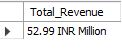

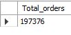

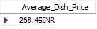

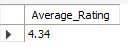

2.Restaurant, Category, and City Analysis

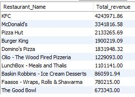

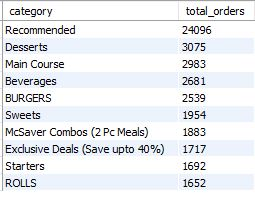

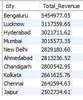

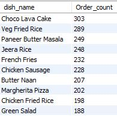

3.Trends and Customer Insights

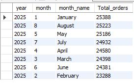

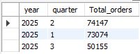

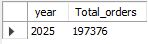

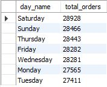

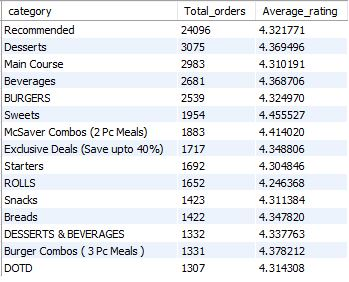

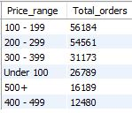

## Skills Demonstrated
- SQL-based data cleaning and preparation
- Database modeling using a star schema
- KPI calculation and business data analysis
- Trend analysis across different time periods
- Translating query results into business insights

## Conclusion
This project demonstrates the use of MySQL to prepare, structure, and analyze sales data. The analysis explores key business metrics and patterns that can support data-driven decision-making.
